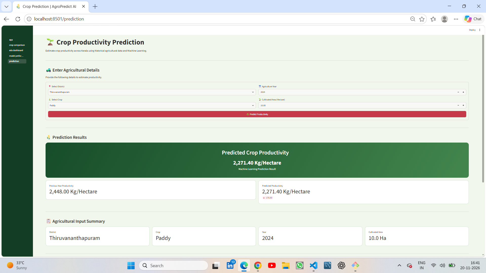
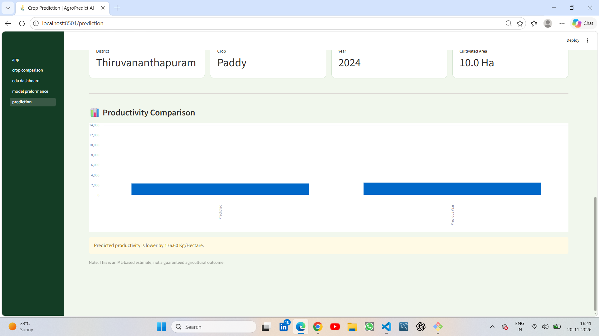
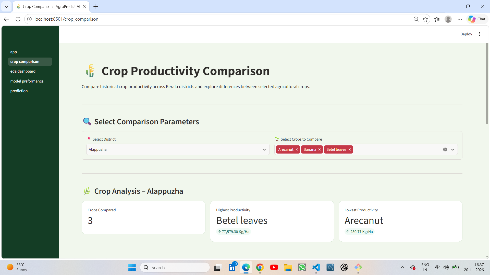
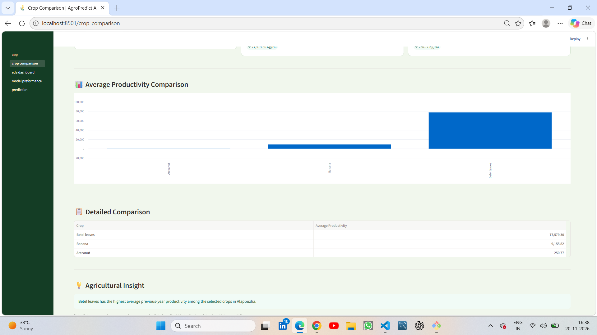
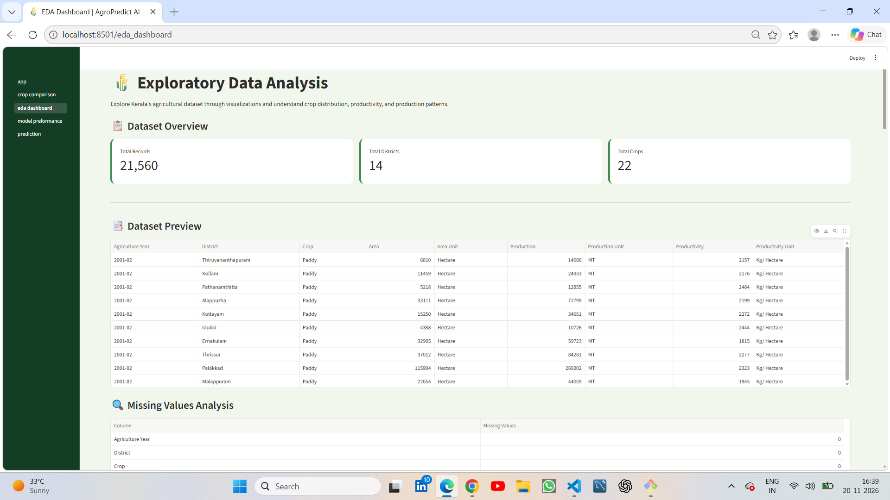
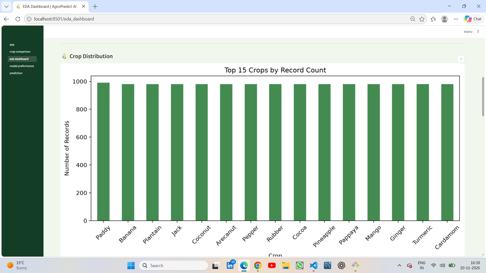
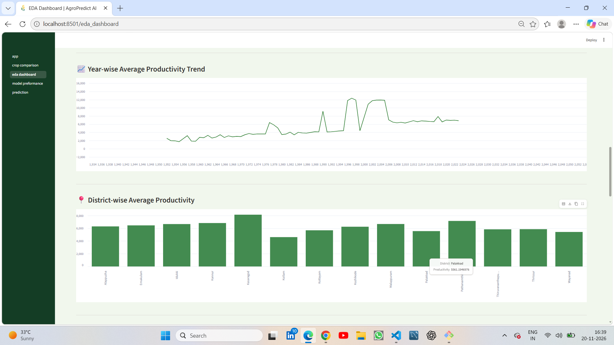
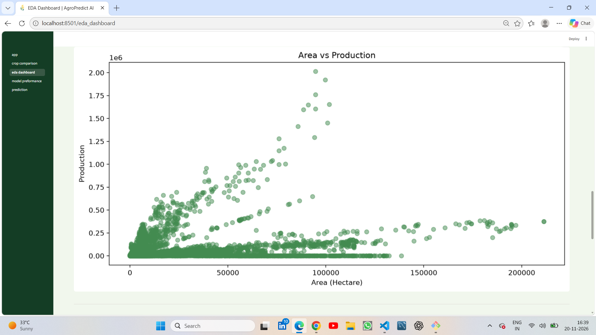
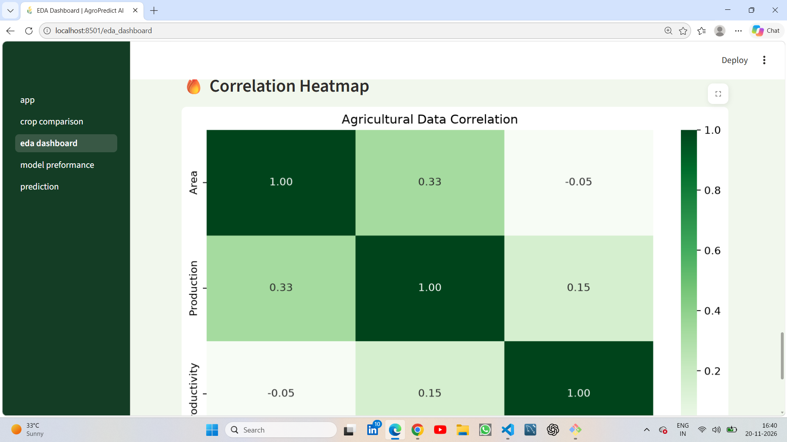

# 🌾 AgroPredict AI – Kerala Crop Productivity Prediction System

## 📌 Project Overview

AgroPredict AI is a Machine Learning-based web application designed to predict agricultural crop productivity across Kerala districts using historical agricultural data.

The application helps users explore historical crop productivity, compare crops, analyse agricultural trends, and predict future productivity based on selected input parameters.

## 🎯 Objectives

- Predict crop productivity using Machine Learning.
- Analyse historical agricultural data across Kerala districts.
- Compare productivity between different crops.
- Visualise agricultural trends through interactive dashboards.
- Support data-driven agricultural analysis.

## 📊 Dataset

The project uses historical Kerala agricultural data containing information about:

- Agriculture Year
- District
- Crop
- Cultivated Area
- Crop Productivity

**Note:** Dataset CSV files are not included in this repository. Add the required datasets to the project folder before running the application.

## ⚙️ Machine Learning Workflow

1. Data Collection
2. Data Preprocessing
3. Exploratory Data Analysis (EDA)
4. Feature Engineering
5. Train-Test Split
6. Model Training
7. Model Evaluation
8. Model Selection

## 🤖 Algorithms Used

- Linear Regression
- Decision Tree Regressor
- Random Forest Regressor
- Extra Trees Regressor
- Gradient Boosting Regressor

**Best Performing Model:** Decision Tree Regressor

## 📈 Model Performance

| Metric | Final Test Result |
|---|---:|
| R² Score | 78.55% |
| MAE | 1295.17 |
| RMSE | 5363.31 |

## 🚀 Application Features

- Crop Productivity Prediction
- Historical Crop Comparison
- Exploratory Data Analysis Dashboard
- District-wise Productivity Analysis
- Model Performance Evaluation

## 🛠️ Technologies Used

- Python
- Pandas
- NumPy
- Matplotlib
- Seaborn
- Scikit-learn
- Streamlit
- Joblib

## 📂 Project Structure

```text
AgroPredict-AI/
│
├── app.py
├── best_model.pkl
├── requirements.txt
├── README.md
│
└── pages/
    ├── prediction.py
    ├── crop_comparison.py
    ├── eda_dashboard.py
    └── model_preformance.py
```

## 💻 How to Run the Project

**Step 1: Clone the repository**

```bash
git clone https://github.com/ShahanaSaifudheen/AgroPredict-AI.git
```

**Step 2: Navigate to the project folder**

```bash
cd AgroPredict-AI
```

**Step 3: Install dependencies**

```bash
pip install -r requirements.txt
```

**Step 4: Add the required dataset files**

Place the following files in the main project folder:

- `kerala_earas_dataset.csv`
- `historical_productivity.csv`

**Step 5: Run the Streamlit application**

```bash
streamlit run app.py
```

## ⚠️ Limitations

- Predictions are based on historical agricultural data.
- Rainfall, temperature, soil conditions, and other environmental factors are not currently included.
- Model predictions should be treated as estimates, not guaranteed agricultural outcomes.

## 👩‍💻 Author

**Shahana Saifudheen**

B.Tech – Artificial Intelligence and Data Science

GitHub: [ShahanaSaifudheen](https://github.com/ShahanaSaifudheen)

## 📸 Application Screenshots

### 🏠 Home Dashboard


### 🔮 Productivity Prediction



### 🌾 Crop Comparison



### 📊 Exploratory Data Analysis (EDA)





